# wag

**Write a slide deck in code. It moves, it talks, and it can walk someone through a real web page.**

Think of the training nobody reads: a document full of screenshots saying "click here, then here". A wag deck does it on the real page instead. It opens the page, points at the button, says what it does, waits while the person clicks it, and checks that it worked. It never presses anything that saves.

<p align="center">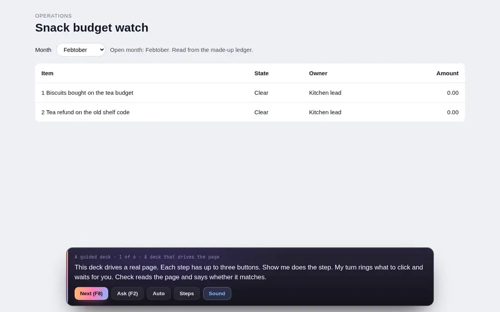</p>

| | |
|---|---|
| **Show me** | The deck does the step on the real page and points at what matters. |
| **Ask** | Stuck? Type a question in the bar on the page. The answer points at the place. |
| **My turn** | Anything that saves is the person's own click. The deck rings it, says what it does, and waits. |
| **Check** | It reads the page, or the file that came down, and says whether the figures agree. |

The same decks also play as ordinary slides, and those look like this. A deck is one TypeScript file; the player animates it with [Motion](https://motion.dev) springs and reads it aloud in a voice that runs on your own machine.

<p align="center">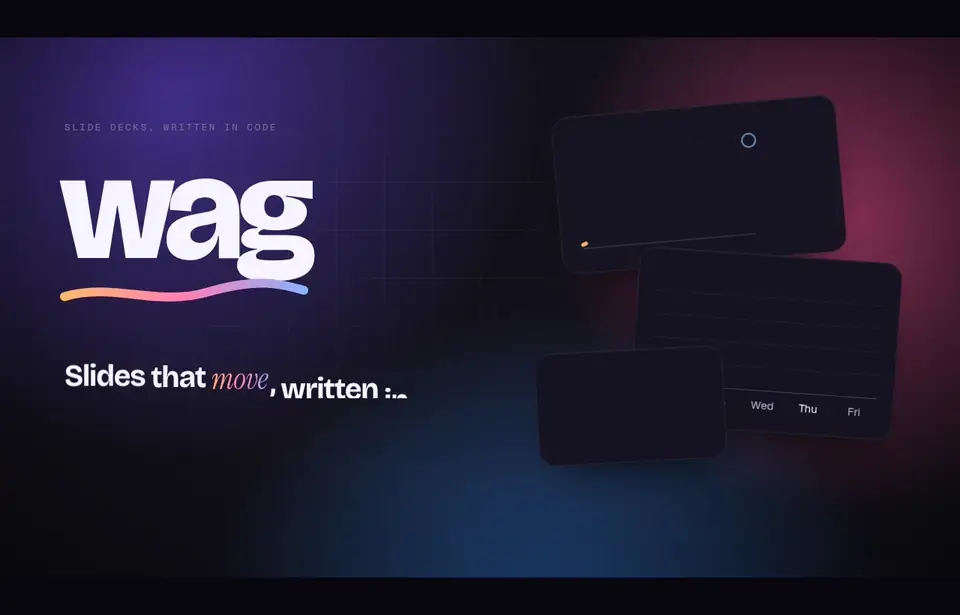</p>

<table><tr>
<td width="33%">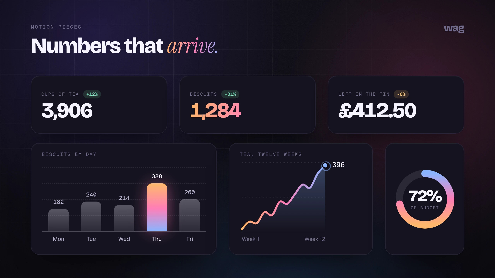</td>
<td width="33%">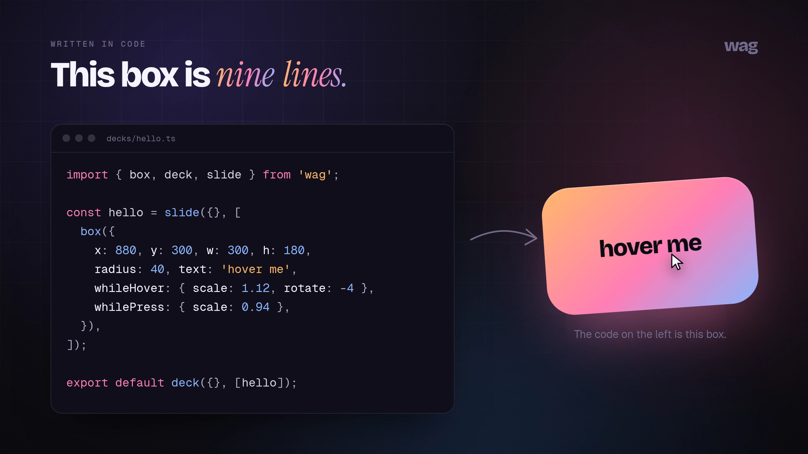</td>
<td width="33%">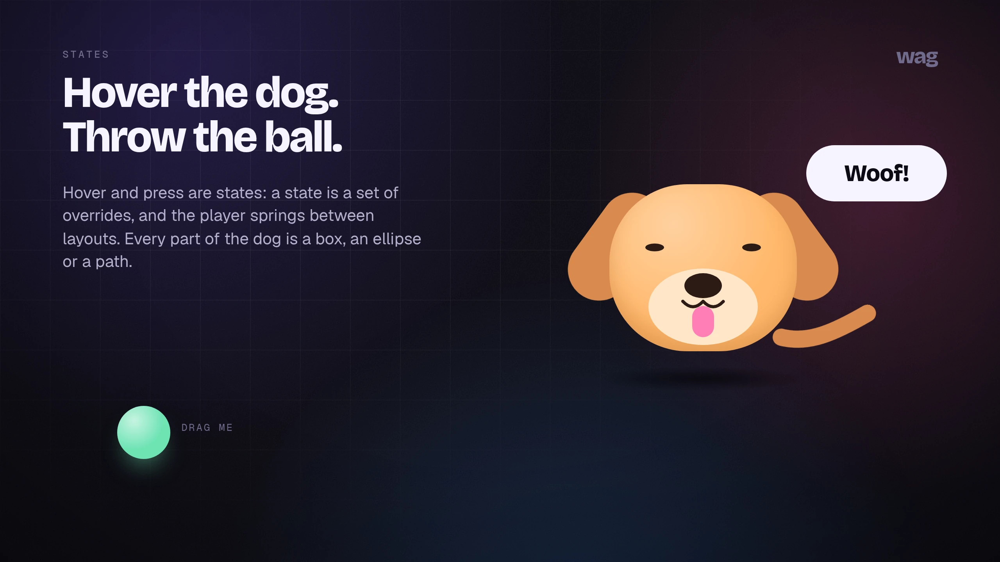</td>
</tr><tr>
<td align="center"><b>Motion pieces</b><br>Figures that count up, bars that grow, a line that draws itself</td>
<td align="center"><b>Written in code</b><br>The code types itself. The box beside it is what it makes</td>
<td align="center"><b>States</b><br>A dog made of boxes, ellipses and a path. Hover it</td>
</tr><tr>
<td>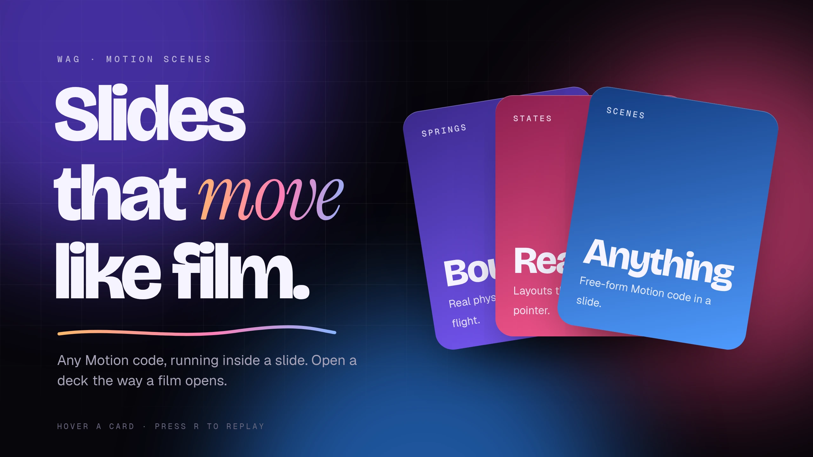</td>
<td>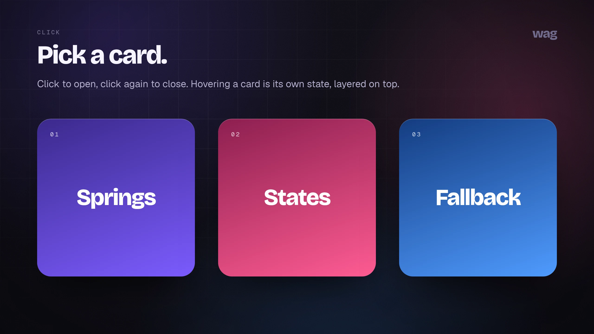</td>
<td>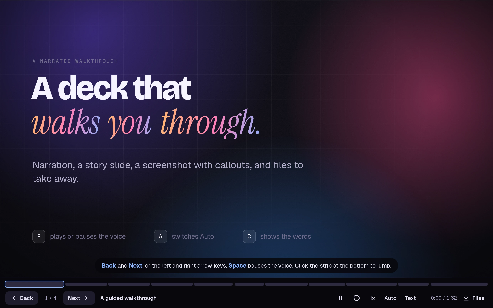</td>
</tr><tr>
<td align="center"><b>Scenes</b><br>A whole slide as one piece of Motion code</td>
<td align="center"><b>Click</b><br>Each card opens to fill the slide, and closes again</td>
<td align="center"><b>Walkthroughs</b><br>A deck that talks, with a timeline to jump around in</td>
</tr></table>

**[Read the docs page](docs/index.html)** (open it from a clone, or at `http://localhost:5179/docs/` while `npm run dev` is running).

| | |
|---|---|
| **Slides that move** | Elements spring between states on hover, click and drag. Type that arrives word by word, charts that draw themselves, builds, morphing transitions, answers saved to Excel, and an export to PowerPoint. |
| **Decks that talk** | Narration line by line in an offline voice, a timeline to jump around in, story slides for cause, effect and fix, screenshots with zooming callouts, and Word handouts. |
| **Guides that drive a page** | **Show me** does a step on the live page. **My turn** rings what to click and waits for you. **Check** reads the page or a downloaded workbook and says whether the figures agree. |

## Quick start

```sh
npm install
npm run dev                          # http://localhost:5179 lists every deck
npx wag new my-deck --kind slides    # a whole starter: slides, ad, training or walkthrough
npx wag check my-deck                # what does not fit, and a picture of every slide
npx wag produce my-deck              # its voice, a check and its video, in one go
npm run build                        # a static copy of the player and every deck, in dist/
npm test
```

`npx wag` is every command under one name. Each is also an `npm run` script (`npm run new`, `check`, `make`, `video`, `produce`).

| Command | What it does |
|---|---|
| `wag new <name> --kind slides\|ad\|training\|walkthrough` | A new deck from a starter of that kind, in a look of its own, with narration. An ad takes `--format wide\|square\|tall` |
| `wag check <deck>` | Plays every slide and step and says what does not fit: text bigger than its box, off the canvas, over other text, too faint to read, lines too long to follow. Writes `wag-check/<deck>/sheet.jpg`, every slide on one sheet. Ends with 1 on a problem |
| `wag make <deck>` | The narration audio, Word handouts and walk |
| `wag video <deck>` | The deck as an mp4 |
| `wag produce <deck>` | `make`, `check` and `video` in one go; a problem stops it (`--force` goes on) |
| `wag video <pack> <deck>` | A video of a real app, the walk played on it (also `wag film`) |
| `wag live <pack>`, `wag rehearse <pack> <deck>` | A live session on an app's pages; a walk played with nobody watching. See [Packs](#packs) |

**For an AI agent:** [`AGENTS.md`](AGENTS.md) is the guide to making a good deck, ad, training video or walkthrough with wag: the loop, how to write the words, how to make it look good. `skills/wag/` is a skill that points an agent working in another project at it.

Example decks ship with the repo, all about made-up things: `demo` (what slides can do), `looks` (a look made from a word), `guide` (a narrated walkthrough) and `guided` (a deck that drives a made-up page, `public/guide/app.html`). `starters/` holds the four starters.

## A slide

```ts
import { box, deck, slide } from 'wag';

const dog = slide(
  { states: { woof: { dog: { scale: 1.3, rotate: -6 }, bubble: { opacity: 1 } } } },
  [
    box({ id: 'dog', x: 500, y: 250, w: 280, h: 280, radius: 36, text: '🐶', hover: 'woof' }),
    box({ id: 'bubble', x: 800, y: 210, w: 210, h: 84, radius: 42, text: 'Woof!', opacity: 0 }),
  ]
);

export default deck({}, [dog]);
```

The canvas is 1280 by 720. A slide is a small state machine: a state is a set of overrides keyed by element id, and the player springs between layouts.

| To | Write |
|---|---|
| Hover, press | `hover: 'state'`, `whileHover: { scale: 1.05 }`, `press`, `whilePress` |
| Click | `click: 'state'` toggles a state |
| Drag | `drag: true`, `'x'` or `'y'`; `snapBack: false` to stay where dropped |
| Entrances | `enter: { dy: 60, opacity: 0 }`, with a slide `stagger` |
| Looping motion | `loop: { rotate: [-3, 3], duration: 0.5 }` |
| Builds | `steps: ['one', 'two']` on the slide |
| Drawn strokes | `path('M6 20 C …', { enter: { draw: 0 } })` |
| Transitions | `transition: 'fade' \| 'push' \| 'zoom' \| 'iris' \| 'morph'` |
| Routing | `slide({ name, hidden })`, `click: { go: 'name' }` (also `next`, `prev`, `back`, a number) |
| Answers | `field(name, …)`, `choice(name, options, …)`, `click: { save: 'file' }` downloads an .xlsx |
| Video | `video('/clip.mp4', { repeat, sound })`, files in `public/` |
| Free-form code | `scene(options, (root, { animate, answers }) => { … })` |
| Narration | `slide({ narration: ['said on arrival', 'said after step 1'] })` |
| Cause, effect and fix | `story({ title, timeline, cause, effect, fix })` |
| A screenshot with callouts | `shot('/pic.png', { size, callouts: [{ at, label, say, issue }] })` |
| Files to take away | `slide({ downloads: [{ label, href }], handout: true })` |
| A whole guide as steps | `guide(options, [{ title, say, show, mine, download, check }])` |
| Picking one out | `shade: 'rgba(2,6,23,.55)'` dims the slide outside an element |

## Layout helpers and formats

Where things go can be worked out instead of counted. Each helper gives `{ x, y, w, h }` boxes, which is what every element takes:

```ts
import { box, cols, grid, inset, page, panel, rows, take, text } from 'wag';

const body = page('wide', { top: 216 });        // the canvas inside its margins, below a heading
const [left, right] = cols(body, [2, 1], 28);    // two columns, 2:1, 28 apart
const cards = grid(body, 3, 2, 24);              // six boxes, three across
box({ ...panel(t), ...cards[0] });
text('Hello', { ...inset(cards[0], 24), fontSize: 24 });
```

`rows` is `cols` turned on its side, `inset(box, pad)` takes room off every side, `take(box, 'top', 60)` is a slice off one side, and `canvas(format)` is the whole canvas.

A deck's canvas is `format: 'wide'` (1280 x 720, the default), `'square'` (1080 x 1080) or `'tall'` (720 x 1280, for a phone); `width` and `height` set any other. A video's shorter side is 1080 pixels unless `--size` says otherwise, so a tall deck is 1080 x 1920.

A deck can also say how it is voiced and filmed, so its video is the same every time. A flag or `WAG_TTS` on the command line wins:

```ts
deck({ ...look(t), assets: '/promo', format: 'tall', voice: 'kokoro', video: { captions: 'burn', music: '/promo/bed.mp3', gap: 0.4 } }, slides);
```

## Type and themes

Typefaces ship as files in the bundle, so a deck looks the same on any machine and in a recording, and nothing is fetched from a font service. The default four are Bricolage Grotesque for headlines, Geist for text, Instrument Serif for marked words and Geist Mono for labels and code (`FONTS` names them); Fraunces, Unbounded, Syne, Space Grotesk, Sora, Playfair Display, Archivo, Inter, Manrope, DM Sans, JetBrains Mono, Space Mono and Caveat ship too, all under the Open Font License, and a face is only downloaded when a slide uses it. A theme is the look in one object: colours, typefaces, how marked words are set, and the light behind a slide. `dark` and `light` ship.

**A fresh look from a word.** Rather than pick from a few themes, make one: `fresh('Q3 launch')` builds a whole look from any word. Light or dark, a tinted ground, a colour scheme around one hue, an accent, a gradient, the light behind the slides, a pairing of typefaces and how marked words are set. Its shape too: round, soft, crisp, sharp or block panels, with the edge and shadow that go with them. And how it moves: a snappy, bouncy, smooth or gentle spring, how elements come in, and how slides arrive. The same word always makes the same look, so the deck in the browser, its video and its PowerPoint agree; another word makes another. Colours are worked out in OKLCH and checked for contrast, so every look reads.

```ts
import { deck, fresh, look } from 'wag';

const t = fresh('Q3 launch');                             // or fresh('Q3 launch', { mood: 'calm' })
// const t = fresh('Acme', { brand: '#ff5a1f', dark: false })   built around your colour
export default deck({ ...look(t) }, [/* slides that use t */]);
```

`look(t)` gives the deck the look's ground, type, spring and slide transition. Three helpers put the rest on a slide, and work with `dark` and `light` as well: `panel(t)` is a panel in the look's shape (`box({ ...panel(t), x, y, w, h })`, or a motion piece as its own card), `headline(t)` is a heading in its type (`text('Hello', { ...headline(t), fontSize: 56, ... })`), and `arrive(t, delay)` is how an element comes in (`enter: arrive(t, 0.2)`).

Moods: `calm`, `bold`, `playful`, `serious`, `warm`, `cool`. To browse, open the dev app's **Fresh looks** page (`npm run dev`, then `/?looks`): many words side by side, your own word, a mood, Shuffle. **Copy** gives the line for your deck; **Play** plays a short deck in that look; **Keep** copies the look as a plain theme, which stays as it is even if a later wag makes that word into something else. Write a deck with `fresh(seedOr('my deck'))` and it can be tried in any look from the address bar (`?deck=my-deck&look=any+word`) or as a video (`npm run video my-deck -- --look "any word"`); `decks/looks.ts` is one.

```ts
import { aurora, dark, deck, look, slide, text } from 'wag';

const t = dark;

const title = slide({}, [
  aurora({ theme: t, strength: 1 }),       // light drifting behind the slide
  text('Slides that *move*', {             // words between asterisks are set in the accent face
    x: 80, y: 260, w: 1120, h: 120,
    font: t.display, fontSize: 104, weight: 800,
    tracking: -0.04, leading: 1,           // letter spacing in ems, line height
    reveal: 'words',                       // each word rises out of its own line
  }),
]);

export default deck({ ...look(t) }, [title]);
```

| To | Write |
|---|---|
| Set type | `font`, `weight`, `italic`, `caps`, `tracking: -0.03`, `leading: 1.1` |
| Mark a word | `'Slides that *move*'`; the deck's `accent` says how marked words look |
| Bring text in | `reveal: 'words'` or `'letters'` |
| A gradient | `gradient: 'linear-gradient(…)'` on a box, an ellipse or text |
| Depth and glass | `shadow: '0 30px 60px -28px rgba(0,0,0,.7)'`, `glass: 16` |
| Decoration | `decor: true` never takes the pointer, and an export leaves it out |

## Motion pieces

Ready-made things that move. Each is one call, sits in a slide the way a box does, plays from the start whenever its slide appears, and takes its colours and type from the theme.

<table><tr>
<td width="50%">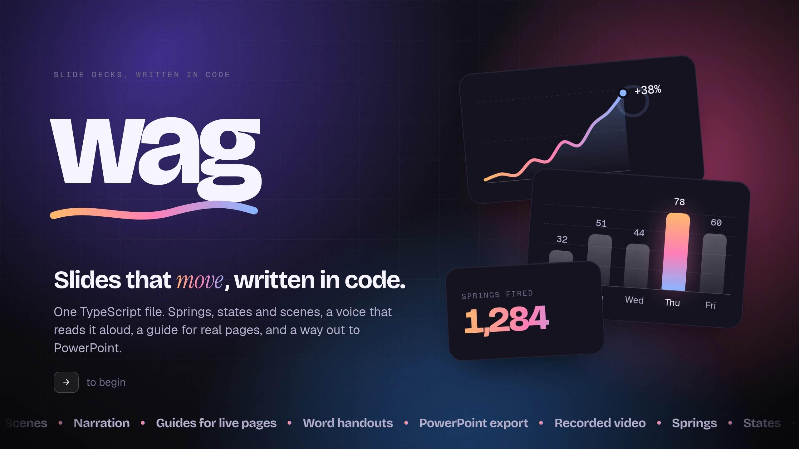</td>
<td width="50%">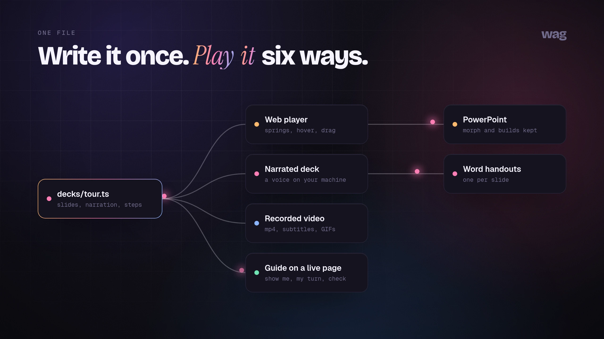</td>
</tr></table>

| Piece | What it does |
|---|---|
| `aurora()` | Light drifting behind a slide: three glows, a faint grid, a little grain |
| `wordmark()` | The wag name, with a tail that wags |
| `stat(1284, { label, delta })` | A figure that counts up |
| `bars([{ label, value }], { mark })` | A bar chart that grows, one bar picked out |
| `trend([…], { labels, end })` | A line chart that draws itself |
| `ring(0.72, { label })` | A ring that fills while its percentage counts |
| `code(source, { file })` | A window of code that types itself, coloured as it goes |
| `flow(nodes, links)` | Boxes joined by lines, with pulses running along them |
| `ticker([…])` | Words passing by in a row that never ends |
| `pointer([{ x, y, click }])` | A cursor that travels and clicks |
| `confetti()` | A burst when the slide arrives |
| `icon(siGithub)`, `icon(Check)` | A logo from [simple-icons](https://simpleicons.org) that pops in, or an icon from [lucide](https://lucide.dev) that draws itself. Import each one from its package, so only the icons a deck uses are in it |
| `scribble('circle')` | A hand-drawn ring, underline, box, arrow, cross or tick ([rough.js](https://roughjs.com)) that draws itself over whatever is under its box. `seed` keeps it the same in every video |

Give a piece a `fill` and a `radius` and it is its own card; `pad` keeps its drawing off the edges. A piece cannot run in PowerPoint, so an export leaves the words it ends on. The backdrop holds still for a viewer whose system asks for reduced motion.

## Walkthroughs

<p align="center">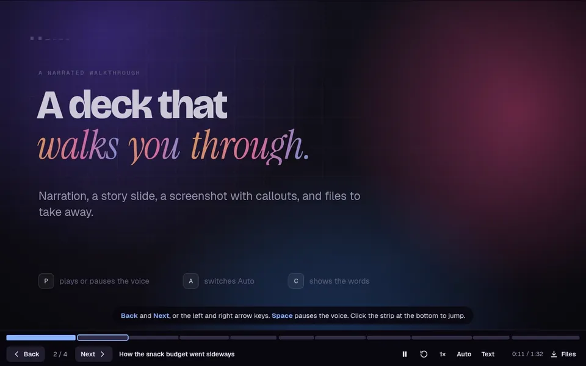</p>

A deck with narration gets a bar under the slide: Back and Next, play and pause, say again, speed, Auto, Text and Files. Across its top runs a timeline with one mark per spoken line, as wide as the line takes to say; click it to jump. Arrow keys move, Space pauses, `A` switches Auto (it waits about two seconds after each line, and Back turns it off), `C` shows the words.

`npm run make <deck>` speaks every line with [Piper](https://github.com/OHF-Voice/piper1-gpl), an offline voice, so the words go nowhere. Without the audio the browser's own voice reads the lines. To set Piper up once:

```sh
python3 -m venv ~/.local/share/wag-voice/venv
~/.local/share/wag-voice/venv/bin/pip install piper-tts
~/.local/share/wag-voice/venv/bin/python -m piper.download_voices en_US-lessac-high --data-dir ~/.local/share/wag-voice/voices
```

`WAG_TTS` picks another voice. All but ElevenLabs run on this machine:

| `WAG_TTS` | The voice | Set up once | Its options |
|---|---|---|---|
| `piper` (default) | [Piper](https://github.com/OHF-Voice/piper1-gpl), offline | above | `WAG_VOICE` (a `.onnx` voice) |
| `kokoro` | [Kokoro](https://huggingface.co/hexgrad/Kokoro-82M), offline, more natural than Piper | `npm i --no-save kokoro-js` (the model, about 90 MB, comes on first use) | `WAG_KOKORO_VOICE` (default `af_heart`), `WAG_KOKORO_SPEED`, `WAG_KOKORO_DTYPE` |
| `pocket` | Kyutai's [pocket-tts](https://pypi.org/project/pocket-tts/), offline on CPU, and it can sound like you | [uv](https://docs.astral.sh/uv/), which fetches it the first time | `WAG_POCKET_VOICE`: one of its voices (`alba`, `marius`, ...) or a clean wav of someone speaking. `WAG_POCKET_PYTHON` to use your own Python |
| `elevenlabs` | [ElevenLabs](https://elevenlabs.io), paid; the lines are sent to it | `ELEVENLABS_API_KEY` | see below |

```sh
WAG_TTS=kokoro npm run make <deck>
WAG_TTS=pocket WAG_POCKET_VOICE=~/me.wav npm run make <deck>
WAG_TTS=elevenlabs ELEVENLABS_API_KEY=... npm run make <deck>
```

Only sound a voice you have the right to: your own, or one its owner agreed to.

`WAG_ELEVENLABS_VOICE` picks the voice by its ID (default George, one of ElevenLabs' own), `WAG_ELEVENLABS_MODEL` the model (default `eleven_multilingual_v2`; `eleven_flash_v2_5` costs half), and `WAG_ELEVENLABS_URL` another region's address. Only lines not said before in that voice are sent, so a second make costs nothing. A walk plays the same audio, so a recording of it carries that voice too.

`ffmpeg` is needed too. Made files go in the folder the deck names with `deck({ assets: '/my-deck' })`, under `public/`; its `audio/`, `handouts/` and `wag.json` are not committed.

## Video

`npm run video <deck>` turns a deck into an mp4: an ad, a promo, a training video. It plays with no bar, and each slide stays for its narration and a short pause after it. The narration is the audio `npm run make` wrote, in whichever voice made it, so make first. A step with nothing to say stays for `--hold` seconds, which is all a deck with no narration needs.

```sh
npm run make promo
npm run video promo -- --out promo.mp4
```

The browser's clock is held and moved on one frame at a time, so every spring, fade and motion piece is drawn whole and smooth however slow the machine. Options: `--fps` (30), `--size` (1080, the shorter side; `--height` sets the height instead), `--hold` (3 s), `--gap` after a line (1 s), `--lead` before a slide's line (0.5 s). It needs Chromium and `ffmpeg`.

**Music and captions.** `--music track.mp3` lays a bed under it all: it loops if it is short, fades in and out, and dips while a line is heard so the voice stays clear (`--music-volume -12` in dB, `--no-duck` to keep it level). Use a track you may use. `--captions srt` writes the lines as subtitles next to the video, timed to the voice; `--captions burn` draws them into the picture as well. No speech recognition is needed: wag knows every word and when it is said.

```sh
npm run video promo -- --music bed.mp3 --captions burn
```

`wag film` takes the same `--music`, `--music-volume`, `--no-duck` and `--captions`, and `--no-bar` to film the page with no words on it. Both are put together by `scripts/media/assemble.mjs`, and every voice lives in `scripts/media/voices.mjs`. A slide that drives a live page plays as its slide alone. To record the live page itself, use `guide record` (see Guided mode).

## Guided mode

<table><tr>
<td>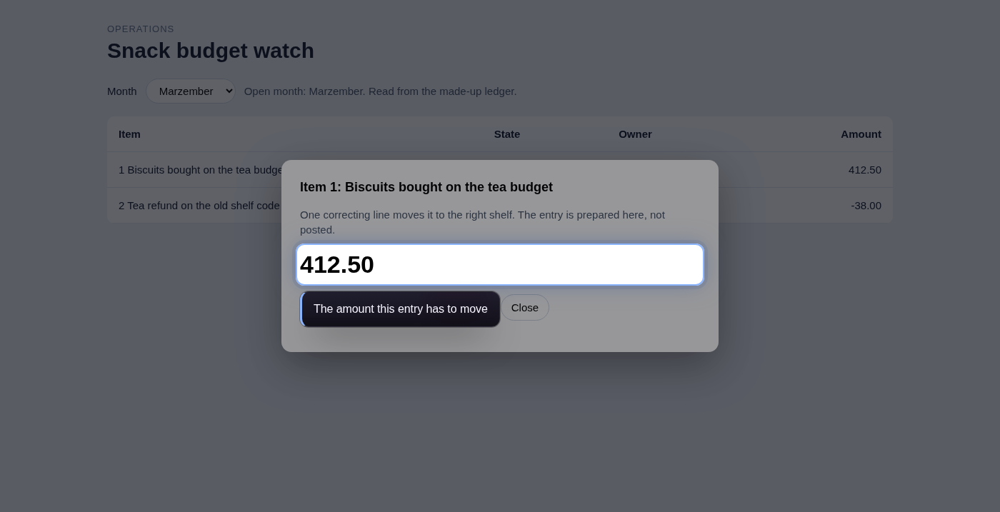</td>
<td>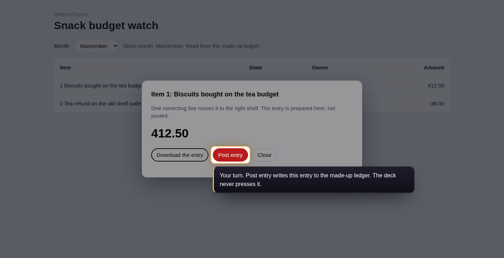</td>
</tr><tr>
<td align="center"><b>Show me</b> opens the item and rings its amount</td>
<td align="center"><b>My turn</b> rings Post entry and waits for your click</td>
</tr></table>

```ts
slide({
  narration: 'Pick the month.',
  live: {
    show: [{ choose: 'Marzember', from: { role: 'combobox', name: 'Month' } }],
    turn: { point: { role: 'combobox', name: 'Month' }, says: 'Choose Marzember. It only changes what is shown.', until: { url: 'month=marzember' } },
    check: [{ label: 'The open month', read: { page: { css: '#read' }, pick: 'Open month: (\\w+)' }, equals: { value: 'Marzember' } }],
  },
}, [...])
```

Show me can also put words in a text box, `{ fill: 'words', into: target }`, and take a branch on a page that differs between versions, `{ if: { see: 'New part' }, then: [...], else: [...] }`. A check with `when` is left out, and said to be, when that part is not on the page.

The driving is done by a small bridge, `scripts/live.mjs`, which uses Playwright to connect to a browser that is already running, over its debugging port. Use a browser with no window for building (the bridge works in a tab of its own and keeps downloads in its own folder):

```sh
chromium --headless=new --remote-debugging-port=9333 --user-data-dir=/tmp/wag-browser &
npm run build
node scripts/live.mjs --serve dist
# open http://127.0.0.1:5180/?deck=guided&key=$(cat /tmp/wag-live/bridge.token)
```

To watch it on your own screen, start the browser with a window and add `--live`: the bridge then works in the tab you are looking at, and downloads become your own click.

**What it will not do.** Before every click the bridge reads the real control's label and refuses anything that saves, posts, approves, submits, deletes, sends or otherwise commits (`COMMITS` in `src/scene.ts`), and any dialog button it cannot classify. Those steps are My turn only, and My turn has to say what the click will do. A label is not trusted on its own, though:

- On a page that is not on this machine, a press, a pick from a list or typing may only read. Anything else the page tries to send while the guide acts is stopped. Two things a browser sends by itself are let through: its report that a page broke its own content rules, and the renewal of a sign-in.
- In a live session a file is yours to take. A download that the guide's own press sets off is cancelled, whatever the button was called.
- "Close", "Cancel", "Back" and "Next" are pressed in a dialog only when that is the whole label.

The words built in are general ones. Your app's own go in a [pack](#packs), or on the bridge's command line: `--changes` (a control that changes something), `--looks` (a dialog button that only looks), `--files-on` (a button that hands over a file). Every start makes a new key, and every command and refusal goes to `bridge.log`.

**Live guide.** `scripts/session.mjs` and the `guide` command let an assistant and a person share one tab: the assistant rings things, reads the page and talks (`guide highlight`, `guide read`, `guide say`), through the same bridge and the same rules. See the [docs page](docs/index.html#live).

**A walk on the page itself.** `npm run make <deck>` also writes a guided deck's steps as `walk.json`. Start the session with `--walk <deck>` and it plays them in the tab it drives, with no slides in between: a bar along the bottom shows each line as text and speaks it, the step's Show me is done, a My turn is waited for, and its Check is read out. `F8` or **Next** goes on. `F2` opens a box to ask a question right there: the walk pauses, the answer shows in the bar, and **Continue** (`F8` again) puts the page back on the step. What the guide could not answer from the page, and anything it would not do, is kept in `open-questions.md` in the session folder.

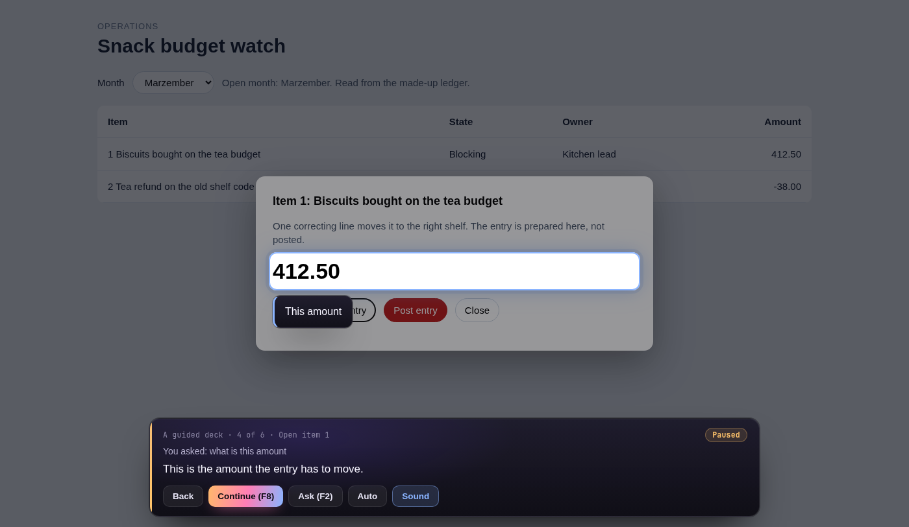

**Jump, ask with nothing playing, rehearse.** The bar's **Steps** list jumps to any step: dialogs are shut and the page is made ready first, by doing again the Show me of the steps since the last one that opens a page. Start the session with `--bar <address>` and the bar is up from the start with no walk playing: a question is answered on whatever page shows the answer, the page stays there, and **Walks** starts any walk the session has. Before you show a walk to anyone, `--rehearse <deck>` plays every step with nobody watching and says which ones work. It never presses a step's own click; it only looks whether the button is there.

```
  1. words only        0 s  A deck that drives the page
  2. works           0.8 s  Open the page
  3. works           0.6 s  Pick the month
  4. failed            6 s  Open item 1
       "A row that is not there" did not show on the page within 6 seconds.
```

**A video of a walk.** `wag film <pack> <deck> --out demo.mp4` plays the walk on the app with nobody watching and films the page as the browser draws it: an app demo or a training video on the real product. Each step's Show me is done while its lines are heard (the audio `npm run make` wrote, ElevenLabs or Piper), the bar shows the words, a step's own click is rung and never pressed, and its Check is read onto the bar. `--size 1280x720` changes the size (default 1920x1080). It uses a tab of its own, never yours, and ends with 1 when a step did not work. For a deck's slides as a video, see Video.

**GIFs of a walk.** `guide record start`, play the walk, then `guide record stop --gif`: next to the video you get `session.gif` and one GIF for each step, with the step's words in the bar so they read with no sound.

In a live session the guide never takes over a tab you had open on something else. It works in the tab in front only when that tab is already on the step's page; otherwise it opens a tab of its own. It never presses a button that hands over a file, whoever asks.

**Ask, inside the deck.** Start the session with `--ask scripts/ask.sh` and the bar gets an Ask button (or press `/`). A question typed there goes to the guide with the step you are on and what the page shows, and the answer comes back as text and voice, one conversation from the first question to the last.

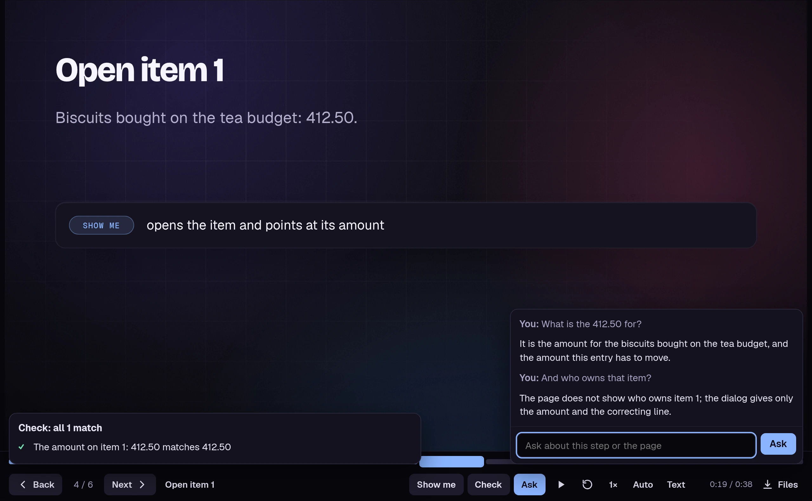

## Packs

A pack is a folder with a `pack.json`: everything a live session needs to know about one app. Keep it wherever suits, outside this repo for an app that is not yours to publish. Paths in it are from the pack's folder.

```json
{
  "app": "https://app.example",
  "start": "/",
  "decks": "out",
  "label": "PRIVATE: real data",
  "pronounce": { "Q3": "quarter three" },
  "looks": ["show the sums", "see why"],
  "changes": ["close the month"],
  "filesOn": ["the entry"],
  "reads": ["/api/search"],
  "ask": { "dir": "notes" },
  "browser": { "cdp": "http://127.0.0.1:9333" }
}
```

| Field | What it says |
|---|---|
| `app`, `start` | Where the app's pages are, and the page the bar opens on when nothing is playing |
| `decks` | The built decks to play |
| `looks`, `changes`, `filesOn` | The app's own words for a dialog button that only looks, a control that changes something, and a button that hands over a file |
| `reads` | Addresses the app reads from with a POST |
| `label`, `pronounce` | A label for the console and recordings; how to say the app's words |
| `ask` | Who answers questions: `dir` holds notes on the pages, `command` another answerer, `prompt` and `model` for the built-in one |
| `browser` | The browser to drive (`cdp`), and where its files go (`files`, `downloads`) |
| `bridge` | A command that runs the bridge on another machine, with `{args}` where its options go |

```sh
npx wag live my-pack                  # the bar on the app's pages: F2 asks, Walks starts a walk
npx wag live my-pack --walk my-deck   # start with a walk
npx wag rehearse my-pack my-deck      # play it with nobody watching and say which steps work
npx wag guide --pack my-pack where    # the guide's commands, pointed at that session
```

`examples/snack` is a pack for the made-up page that ships with wag.

## Private decks

A deck made from private material should not sit in this repo. Point `WAG_DECKS` at a folder elsewhere; its decks are listed with the repo's own and its `public/` is served the same way.

```sh
WAG_DECKS=~/private-decks npm run dev
WAG_DECKS=~/private-decks WAG_OUT=~/private-decks/out npm run build
```

## PowerPoint

The start page has a **Download .pptx** button for each deck. Entrances and builds become native animations, and hover and click states become hidden slides joined by Morph. Drag, loops, scenes, video, narration and live steps are not carried over.

## Where things are

- `src/scene.ts`: the deck format and its builders
- `src/kit.ts`: ready-made slides (`story`, `shot`, `guide`)
- `src/layout.ts`: `page`, `cols`, `rows`, `grid`, `inset`, `take` and the formats
- `src/theme.ts`: the `dark` and `light` themes
- `src/fresh.ts`: `fresh()`, a whole look from a word
- `src/motion.ts`: the motion pieces
- `src/fonts.ts`: the typefaces in the bundle
- `src/player.ts`: the browser player, with the bar and the timeline
- `src/pptx.ts`: the .pptx exporter
- `app/`: the page that lists and plays decks
- `decks/`: one file per deck
- `docs/`: the docs page, its pictures, and its copy of the fonts with their licences
- `bin/wag.mjs`: the `wag` command, and what a pack is
- `examples/snack/`: a pack for the made-up page
- `tests/`: `npm test`, the bridge and the session against the made-up page
- `scripts/new.mjs` and `starters/`: a new deck from a starter
- `scripts/check.mjs`: what does not fit, and a picture of every slide
- `scripts/produce.mjs`: make, check and video in one go
- `scripts/make.mjs`: narration audio and Word handouts
- `scripts/video.mjs`: a deck to an mp4
- `scripts/media/`: the media library: voices (`voices.mjs`, `pocket.py`) and the stage a deck is played on with its clock held (`stage.mjs`), and putting a video together with its voice, music and captions (`assemble.mjs`)
- `scripts/live.mjs`: the bridge that drives a browser
- `scripts/session.mjs`, `scripts/guide.mjs`, `scripts/voice.py`: the live guide
- `scripts/ask.sh`: an answerer for the Ask box, using Claude Code
- `spike/`: the script that first tested which animation XML PowerPoint accepts

wag is an early prototype. `npm test` runs the bridge and the live session as their own programs against the made-up page, in a browser with no window: what they do, and above all what they refuse. It needs a Chromium on the machine. The slides, the player and the PowerPoint export are still checked by hand.
