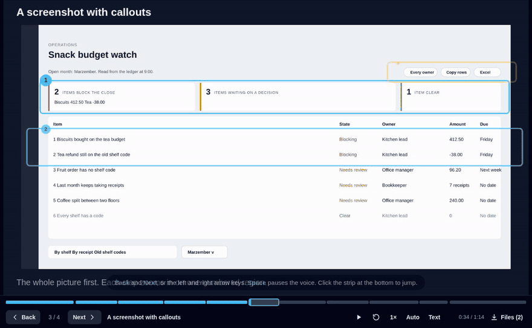
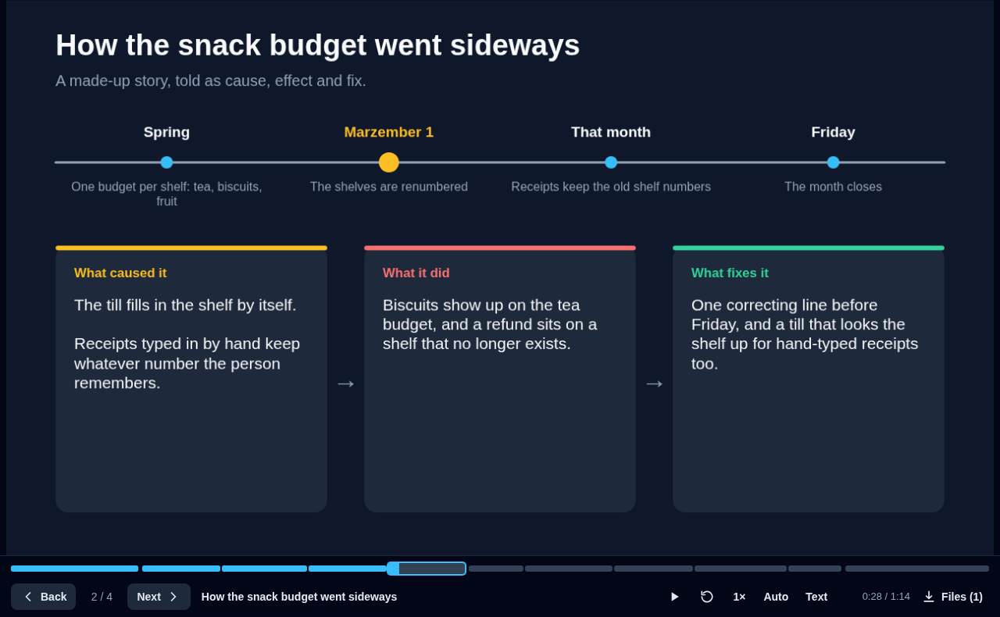
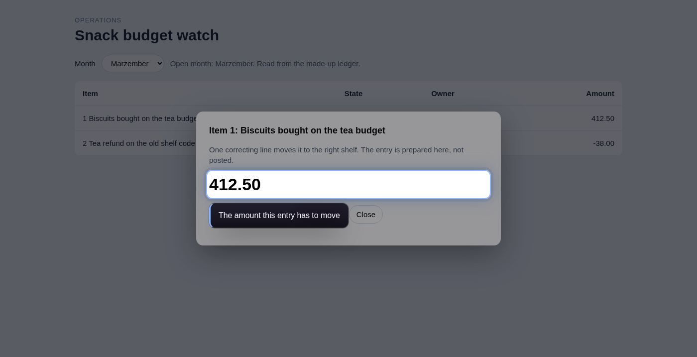
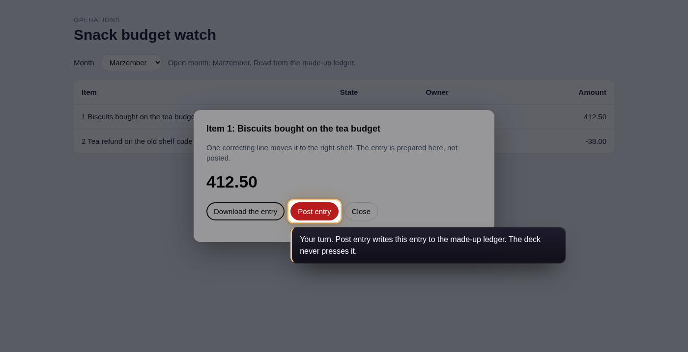
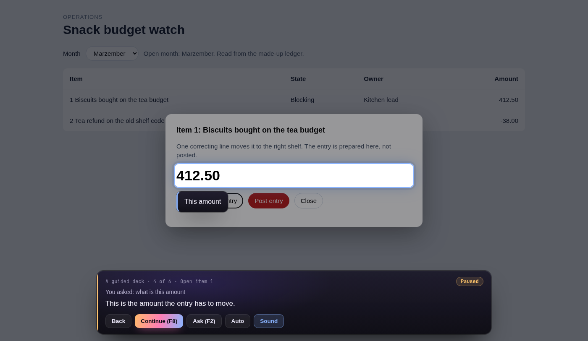
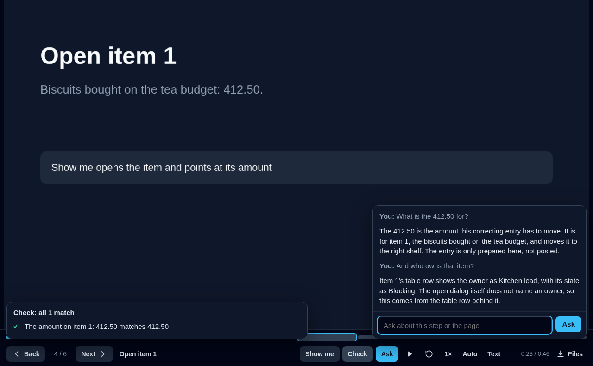

# wag

**Slide decks written in code. They move, they talk, and they can walk someone through a real web page.**

A deck is one TypeScript file. The player animates it with [Motion](https://motion.dev) springs and reads it aloud in a voice that runs on your own machine. In guided mode it points at a live page in a browser you are already signed in to, and it never presses anything that saves.

<p align="center"></p>

**[Read the docs page](docs/index.html)** (open it from a clone, or at `http://localhost:5179/docs/` while `npm run dev` is running).

| | |
|---|---|
| **Slides that move** | Elements spring between states on hover, click and drag. Builds, drawn strokes, morphing transitions, routes between slides, answers saved to Excel, and an export to PowerPoint. |
| **Decks that talk** | Narration line by line in an offline voice, a timeline to jump around in, story slides for cause, effect and fix, screenshots with zooming callouts, and Word handouts. |
| **Guides that drive a page** | **Show me** does a step on the live page. **My turn** rings what to click and waits for you. **Check** reads the page or a downloaded workbook and says whether the figures agree. |

## Quick start

```sh
npm install
npm run dev              # http://localhost:5179 lists every deck
npm run new my-deck      # decks/my-deck.ts, from a small starter
npm run make guide       # narration audio and Word handouts for a deck
npm run build            # a static copy of the player and every deck, in dist/
npm test                 # the bridge and the live session, against the made-up page
```

`npx wag` is the same under one name (`wag new`, `wag dev`, `wag make`, `wag build`), with two more for a live session on an app's pages: `wag live <pack>` and `wag rehearse <pack> <deck>`. See [Packs](#packs).

Three decks ship with the repo, all about made-up things: `demo` (what slides can do), `guide` (a narrated walkthrough) and `guided` (a deck that drives a made-up page, `public/guide/app.html`).

## A slide

```ts
import { box, deck, slide } from 'wag';

const dog = slide(
  { states: { woof: { dog: { scale: 1.3, rotate: -6 }, bubble: { opacity: 1 } } } },
  [
    box({ id: 'dog', x: 500, y: 250, w: 280, h: 280, radius: 36, text: '🐶', hover: 'woof' }),
    box({ id: 'bubble', x: 800, y: 210, w: 210, h: 84, radius: 42, text: 'Woof!', opacity: 0 }),
  ]
);

export default deck({}, [dog]);
```

The canvas is 1280 by 720. A slide is a small state machine: a state is a set of overrides keyed by element id, and the player springs between layouts.

| To | Write |
|---|---|
| Hover, press | `hover: 'state'`, `whileHover: { scale: 1.05 }`, `press`, `whilePress` |
| Click | `click: 'state'` toggles a state |
| Drag | `drag: true`, `'x'` or `'y'`; `snapBack: false` to stay where dropped |
| Entrances | `enter: { dy: 60, opacity: 0 }`, with a slide `stagger` |
| Looping motion | `loop: { rotate: [-3, 3], duration: 0.5 }` |
| Builds | `steps: ['one', 'two']` on the slide |
| Drawn strokes | `path('M6 20 C …', { enter: { draw: 0 } })` |
| Transitions | `transition: 'fade' \| 'push' \| 'zoom' \| 'iris' \| 'morph'` |
| Routing | `slide({ name, hidden })`, `click: { go: 'name' }` (also `next`, `prev`, `back`, a number) |
| Answers | `field(name, …)`, `choice(name, options, …)`, `click: { save: 'file' }` downloads an .xlsx |
| Video | `video('/clip.mp4', { repeat, sound })`, files in `public/` |
| Free-form code | `scene(options, (root, { animate, answers }) => { … })` |
| Narration | `slide({ narration: ['said on arrival', 'said after step 1'] })` |
| Cause, effect and fix | `story({ title, timeline, cause, effect, fix })` |
| A screenshot with callouts | `shot('/pic.png', { size, callouts: [{ at, label, say, issue }] })` |
| Files to take away | `slide({ downloads: [{ label, href }], handout: true })` |
| A whole guide as steps | `guide(options, [{ title, say, show, mine, download, check }])` |
| Picking one out | `shade: 'rgba(2,6,23,.55)'` dims the slide outside an element |

## Walkthroughs



A deck with narration gets a bar under the slide: Back and Next, play and pause, say again, speed, Auto, Text and Files. Across its top runs a timeline with one mark per spoken line, as wide as the line takes to say; click it to jump. Arrow keys move, Space pauses, `A` switches Auto (it waits about two seconds after each line, and Back turns it off), `C` shows the words.

`npm run make <deck>` speaks every line with [Piper](https://github.com/OHF-Voice/piper1-gpl), an offline voice, so the words go nowhere. Without the audio the browser's own voice reads the lines. To set Piper up once:

```sh
python3 -m venv ~/.local/share/wag-voice/venv
~/.local/share/wag-voice/venv/bin/pip install piper-tts
~/.local/share/wag-voice/venv/bin/python -m piper.download_voices en_US-lessac-high --data-dir ~/.local/share/wag-voice/voices
```

`ffmpeg` is needed too. Made files go in the folder the deck names with `deck({ assets: '/my-deck' })`, under `public/`; its `audio/`, `handouts/` and `wag.json` are not committed.

## Guided mode

<table><tr>
<td></td>
<td></td>
</tr><tr>
<td align="center"><b>Show me</b> opens the item and rings its amount</td>
<td align="center"><b>My turn</b> rings Post entry and waits for your click</td>
</tr></table>

```ts
slide({
  narration: 'Pick the month.',
  live: {
    show: [{ choose: 'Marzember', from: { role: 'combobox', name: 'Month' } }],
    turn: { point: { role: 'combobox', name: 'Month' }, says: 'Choose Marzember. It only changes what is shown.', until: { url: 'month=marzember' } },
    check: [{ label: 'The open month', read: { page: { css: '#read' }, pick: 'Open month: (\\w+)' }, equals: { value: 'Marzember' } }],
  },
}, [...])
```

Show me can also put words in a text box, `{ fill: 'words', into: target }`, and take a branch on a page that differs between versions, `{ if: { see: 'New part' }, then: [...], else: [...] }`. A check with `when` is left out, and said to be, when that part is not on the page.

The driving is done by a small bridge, `scripts/live.mjs`, which uses Playwright to connect to a browser that is already running, over its debugging port. Use a browser with no window for building (the bridge works in a tab of its own and keeps downloads in its own folder):

```sh
chromium --headless=new --remote-debugging-port=9333 --user-data-dir=/tmp/wag-browser &
npm run build
node scripts/live.mjs --serve dist
# open http://127.0.0.1:5180/?deck=guided&key=$(cat /tmp/wag-live/bridge.token)
```

To watch it on your own screen, start the browser with a window and add `--live`: the bridge then works in the tab you are looking at, and downloads become your own click.

**What it will not do.** Before every click the bridge reads the real control's label and refuses anything that saves, posts, approves, submits, deletes, sends or otherwise commits (`COMMITS` in `src/scene.ts`), and any dialog button it cannot classify. Those steps are My turn only, and My turn has to say what the click will do. A label is not trusted on its own, though:

- On a page that is not on this machine, a press, a pick from a list or typing may only read. Anything else the page tries to send while the guide acts is stopped. Two things a browser sends by itself are let through: its report that a page broke its own content rules, and the renewal of a sign-in.
- In a live session a file is yours to take. A download that the guide's own press sets off is cancelled, whatever the button was called.
- "Close", "Cancel", "Back" and "Next" are pressed in a dialog only when that is the whole label.

The words built in are general ones. Your app's own go in a [pack](#packs), or on the bridge's command line: `--changes` (a control that changes something), `--looks` (a dialog button that only looks), `--files-on` (a button that hands over a file). Every start makes a new key, and every command and refusal goes to `bridge.log`.

**Live guide.** `scripts/session.mjs` and the `guide` command let an assistant and a person share one tab: the assistant rings things, reads the page and talks (`guide highlight`, `guide read`, `guide say`), through the same bridge and the same rules. See the [docs page](docs/index.html#live).

**A walk on the page itself.** `npm run make <deck>` also writes a guided deck's steps as `walk.json`. Start the session with `--walk <deck>` and it plays them in the tab it drives, with no slides in between: a bar along the bottom shows each line as text and speaks it, the step's Show me is done, a My turn is waited for, and its Check is read out. `F8` or **Next** goes on. `F2` opens a box to ask a question right there: the walk pauses, the answer shows in the bar, and **Continue** (`F8` again) puts the page back on the step. What the guide could not answer from the page, and anything it would not do, is kept in `open-questions.md` in the session folder.



**Jump, ask with nothing playing, rehearse.** The bar's **Steps** list jumps to any step: dialogs are shut and the page is made ready first, by doing again the Show me of the steps since the last one that opens a page. Start the session with `--bar <address>` and the bar is up from the start with no walk playing: a question is answered on whatever page shows the answer, the page stays there, and **Walks** starts any walk the session has. Before you show a walk to anyone, `--rehearse <deck>` plays every step with nobody watching and says which ones work. It never presses a step's own click; it only looks whether the button is there.

```
  1. words only        0 s  A deck that drives the page
  2. works           0.8 s  Open the page
  3. works           0.6 s  Pick the month
  4. failed            6 s  Open item 1
       "A row that is not there" did not show on the page within 6 seconds.
```

**GIFs of a walk.** `guide record start`, play the walk, then `guide record stop --gif`: next to the video you get `session.gif` and one GIF for each step, with the step's words in the bar so they read with no sound.

In a live session the guide never takes over a tab you had open on something else. It works in the tab in front only when that tab is already on the step's page; otherwise it opens a tab of its own. It never presses a button that hands over a file, whoever asks.

**Ask, inside the deck.** Start the session with `--ask scripts/ask.sh` and the bar gets an Ask button (or press `/`). A question typed there goes to the guide with the step you are on and what the page shows, and the answer comes back as text and voice, one conversation from the first question to the last.



## Packs

A pack is a folder with a `pack.json`: everything a live session needs to know about one app. Keep it wherever suits, outside this repo for an app that is not yours to publish. Paths in it are from the pack's folder.

```json
{
  "app": "https://app.example",
  "start": "/",
  "decks": "out",
  "label": "PRIVATE: real data",
  "pronounce": { "Q3": "quarter three" },
  "looks": ["show the sums", "see why"],
  "changes": ["close the month"],
  "filesOn": ["the entry"],
  "reads": ["/api/search"],
  "ask": { "dir": "notes" },
  "browser": { "cdp": "http://127.0.0.1:9333" }
}
```

| Field | What it says |
|---|---|
| `app`, `start` | Where the app's pages are, and the page the bar opens on when nothing is playing |
| `decks` | The built decks to play |
| `looks`, `changes`, `filesOn` | The app's own words for a dialog button that only looks, a control that changes something, and a button that hands over a file |
| `reads` | Addresses the app reads from with a POST |
| `label`, `pronounce` | A label for the console and recordings; how to say the app's words |
| `ask` | Who answers questions: `dir` holds notes on the pages, `command` another answerer, `prompt` and `model` for the built-in one |
| `browser` | The browser to drive (`cdp`), and where its files go (`files`, `downloads`) |
| `bridge` | A command that runs the bridge on another machine, with `{args}` where its options go |

```sh
npx wag live my-pack                  # the bar on the app's pages: F2 asks, Walks starts a walk
npx wag live my-pack --walk my-deck   # start with a walk
npx wag rehearse my-pack my-deck      # play it with nobody watching and say which steps work
npx wag guide --pack my-pack where    # the guide's commands, pointed at that session
```

`examples/snack` is a pack for the made-up page that ships with wag.

## Private decks

A deck made from private material should not sit in this repo. Point `WAG_DECKS` at a folder elsewhere; its decks are listed with the repo's own and its `public/` is served the same way.

```sh
WAG_DECKS=~/private-decks npm run dev
WAG_DECKS=~/private-decks WAG_OUT=~/private-decks/out npm run build
```

## PowerPoint

The start page has a **Download .pptx** button for each deck. Entrances and builds become native animations, and hover and click states become hidden slides joined by Morph. Drag, loops, scenes, video, narration and live steps are not carried over.

## Layout

- `src/scene.ts`: the deck format and its builders
- `src/kit.ts`: ready-made slides (`story`, `shot`, `guide`) and themes
- `src/player.ts`: the browser player, with the bar and the timeline
- `src/pptx.ts`: the .pptx exporter
- `app/`: the page that lists and plays decks
- `decks/`: one file per deck
- `docs/`: the docs page and its pictures
- `bin/wag.mjs`: the `wag` command, and what a pack is
- `examples/snack/`: a pack for the made-up page
- `tests/`: `npm test`, the bridge and the session against the made-up page
- `scripts/make.mjs`: narration audio and Word handouts
- `scripts/live.mjs`: the bridge that drives a browser
- `scripts/session.mjs`, `scripts/guide.mjs`, `scripts/voice.py`: the live guide
- `scripts/ask.sh`: an answerer for the Ask box, using Claude Code
- `spike/`: the script that first tested which animation XML PowerPoint accepts

wag is an early prototype. `npm test` runs the bridge and the live session as their own programs against the made-up page, in a browser with no window: what they do, and above all what they refuse. It needs a Chromium on the machine. The slides, the player and the PowerPoint export are still checked by hand.
